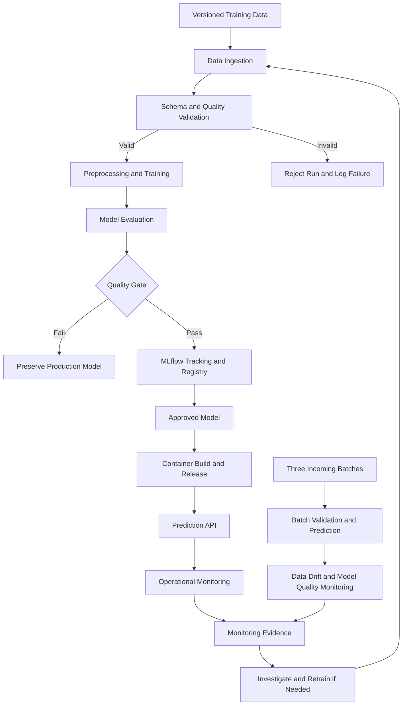

# House Price MLOps Architecture

## Component responsibilities

- **Data ingestion:** loads configured training and incoming datasets.
- **Validation:** rejects invalid schema, identifiers, ranges and values.
- **Training:** fits the configured regression pipeline.
- **Evaluation:** checks candidate performance against configured thresholds.
- **MLflow:** records experiments and model versions.
- **Release:** packages an approved model for serving.
- **API:** exposes predictions.
- **Monitoring:** records service metrics and evaluates all three incoming batches.
- **Safe failure:** a failed gate must not replace the current production model.
