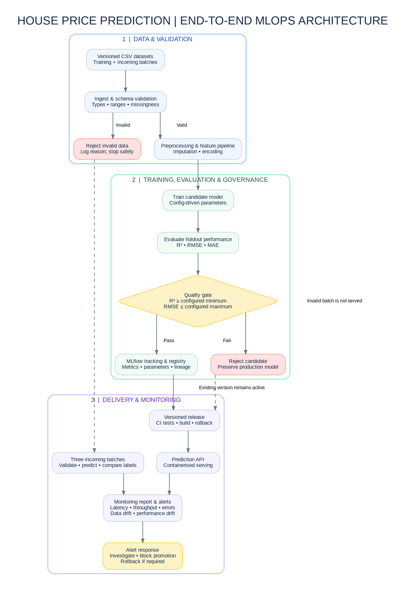

# House Price Prediction MLOps — Design Note

## Problem and objective
Predict `Price_Lakhs` using property attributes from the supplied training
dataset. The system must make training reproducible, reject invalid data,
prevent unsafe model promotion, record lineage, serve predictions and monitor
three incoming batches.

## Architecture and lifecycle mapping

## Configuration and reproducibility
`configs/config.yaml` is the source of truth for data paths, model parameters
and evaluation thresholds. Git versions code, configuration and supplied data.
MLflow records experiment runs and registered models. Each release should be
traceable to its commit, configuration, data version and training run.

## Quality gates and threshold rationale
The current configuration requires R² >= 0.50 and RMSE <= 50 lakhs.
R² prevents promotion of a candidate with weak predictive performance;
the RMSE ceiling limits absolute prediction error. These are initial
project guardrails, not universal industry standards. The observed baseline
holdout metrics (R² approximately 0.819; RMSE approximately 9.344 lakhs)
provide a reference for reviewing and tightening them. The final report
must disclose the thresholds and observed results.

Invalid data or a candidate failing a gate must stop promotion. The previous
production model must remain available. Tests must verify this behaviour.

## Serving and monitoring
Package the approved model in a containerised API. For each incoming batch,
report validation outcomes, data drift, and performance metrics using the
provided target labels. Record API latency, throughput, error rate and
prediction distribution. Explain alert thresholds and the response to alerts.

## Lifecycle component mapping
- Ingestion and validation: data-quality stage.
- Preprocessing, training and evaluation: model-development stage.
- Quality gate and MLflow: approval, tracking and registry stages.
- Container and API: release and serving stages.
- Batch and API metrics: monitoring stage.
- Rejection and rollback: safe-failure controls.

## AI assistance disclosure
AI assistance was used to help draft documentation and troubleshoot code.
The team must review, understand and validate all implementation and results.
